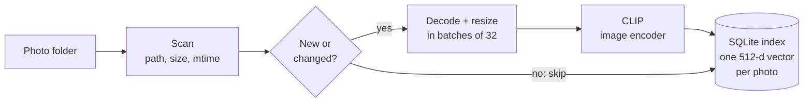
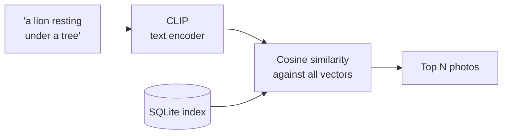

# wildsearch

**Search any photo folder from the command line by describing what's in it.** Runs
entirely on your laptop (currently only tested on MacOS)

Initially built for, and evaluated on, wildlife photography. Because it uses OpenCLIP
models trained on about two billion image–text pairs from the web, it works just as well
for any kind of photo: landscapes, cities, people, food, documents.

## Why

Imagine a week-long photography trip in Kenya. That's easily 10,000 photos a day. Back home you remember a very specific moment: *the leopard yawning on a branch at dusk*, *two zebras crossing the river*, *a lion resting under a tree at sunset*. But it's one frame among 70,000 files called `DSC_4821.JPG`, and scrolling through
thumbnails takes hours.

With wildsearch you index the trip folder once, then describe the moment you remember:

```console
$ wildsearch search "a lion resting under a tree at sunset" -p ~/Pictures/Kenya2026
```

The indexing takes some time, but only needs to be done once. After, the best matches come back in seconds. The same works for decades of family photos spread over old hard drives, where nobody remembers which folder anything is in.


## Example Usage

Here is an example usage of the application. First, index the folder you want to search. Then you can search for specific pictures, e.g., "a lion resting under a tree at sunset". Status shows you what folders are currently indexed and you can decide to forget a specific folder, which deletes that folders index, or you can reset, which deletes all the indexes.

```console
$ wildsearch index ~/Pictures/Kenya2026
~/Pictures/Kenya2026: 1,240 new, 0 changed, 0 removed
✓ Embedded 1,240 photos

$ wildsearch search "a lion resting under a tree at sunset" -p ~/Pictures/Kenya2026 -n 3 --open
  #  Score  Photo
  1  0.312  day3/IMG_0412.jpg
  2  0.305  day3/IMG_0415.jpg
  3  0.271  day1/IMG_0088.jpg
Searched all 1,240 photos in ~/Pictures/Kenya2026.

$ wildsearch status
Index: ~/Library/Application Support/wildsearch/index.db  (2.6 MB)
Folder                 Photos  Embedded  Last indexed
~/Pictures/Kenya2026    1,240     1,240  2026-10-24 18:15

$ wildsearch forget ~/Pictures/Kenya2026
✓ ~/Pictures/Kenya2026: forgot 1,240 photos

$ wildsearch status
Nothing indexed yet. Run: wildsearch index FOLDER
```

Keyword search (like Finder's) can find *lion*. wildsearch can find *a lion resting under
a tree at sunset*, or *an animal camouflaged in tall grass*: any description, in plain
language, without anyone having labelled the photos first.

## How it works

wildsearch uses [CLIP](https://openai.com/research/clip)-style models
([OpenCLIP](https://github.com/mlfoundations/open_clip)), which map images and text into
the **same vector space**: a photo and a sentence that describe the same thing end up close
together. Searching is then a nearest-neighbour lookup.

**`wildsearch index`**: once per folder, then only new or changed photos.



**`wildsearch search`**



- **Indexing** embeds each photo once and stores its vector (2 KB) in a local SQLite file.
  Re-running `index` only processes new or changed photos, and an interrupted run resumes. This only takes time the first time.
  where it stopped: progress is committed after every batch.
- **Searching** never opens a photo. It embeds the query and compares it with all stored
  vectors in one matrix multiplication, which takes milliseconds even for tens of
  thousands of photos.

## Install

Requires Python 3.12+ and uv

```console
$ git clone https://github.com/<you>/wildsearch && cd wildsearch
$ uv tool install --editable ".[ml]"
```

This puts a `wildsearch` command on your PATH. The model weights (~350 MB) are downloaded
on first use and cached; after that everything runs offline.

## Commands

| Command | What it does |
|---|---|
| `wildsearch index FOLDER…` | Embed new and changed photos, forget deleted ones |
| `wildsearch search "QUERY" [-p FOLDER] [-n 10] [--open]` | Best matches; `-p` defaults to the current folder, `--open` shows them in Preview |
| `wildsearch status` | Indexed folders, photo counts, database size |
| `wildsearch forget FOLDER…` | Remove folders from the index |
| `wildsearch reset` | Delete the whole index |

Photo files are never modified. The index lives in your user data folder
(`~/Library/Application Support/wildsearch/index.db` on macOS); use `--db` or
`WILDSEARCH_DB` environment variable to put it elsewhere.

## Performance

Measured stage by stage on two folders at opposite ends: 11,788 small photos from
[CUB-200-2011](https://www.vision.caltech.edu/datasets/cub_200_2011), and 23 full-size
40-megapixel camera JPEGs. Full method and numbers in [benchmarks.md](benchmarks.md).

| Change | Effect (CUB, 11,788 photos) |
|---|---|
| Batched embedding | Peak memory **41.9 GB → 1.57 GB** (27× less) at the same speed |
| Batch size 1 → 32 | **2.6× faster** embedding |

<!-- TODO: add the indexing result (search time before vs after) once measured. -->

## Design

```
src/wildsearch/
  cli.py       Typer commands; output only, no logic
  scanner.py   finds image files recursively, with size and mtime
  images.py    opens a file as an upright RGB image
  embedder.py  the Embedder protocol
  clip.py      ClipEmbedder (open_clip); the only module that imports PyTorch
  store.py     SQLite: photos, vectors per (photo, model), indexed folders
  indexer.py   sync a folder with the index, embed what's missing
  search.py    rank stored vectors against a query vector
```

## Limitations

- JPEG, PNG, WebP and TIFF only; camera RAW and HEIC are not supported yet.
- A corrupt image currently stops `index`.
- `--open` is macOS-only.
